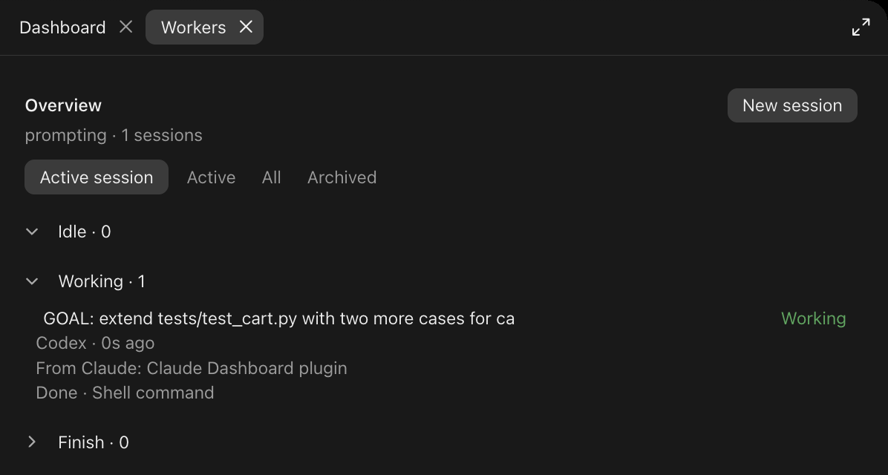
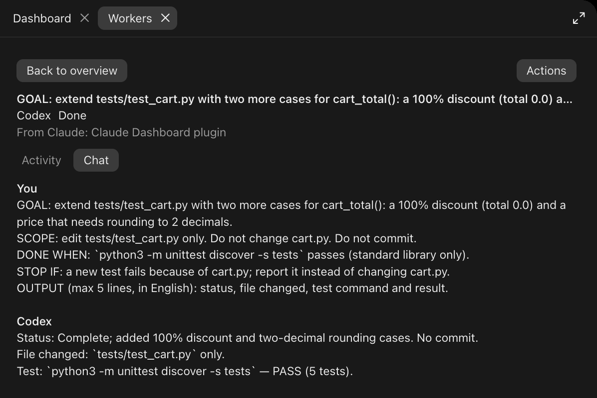
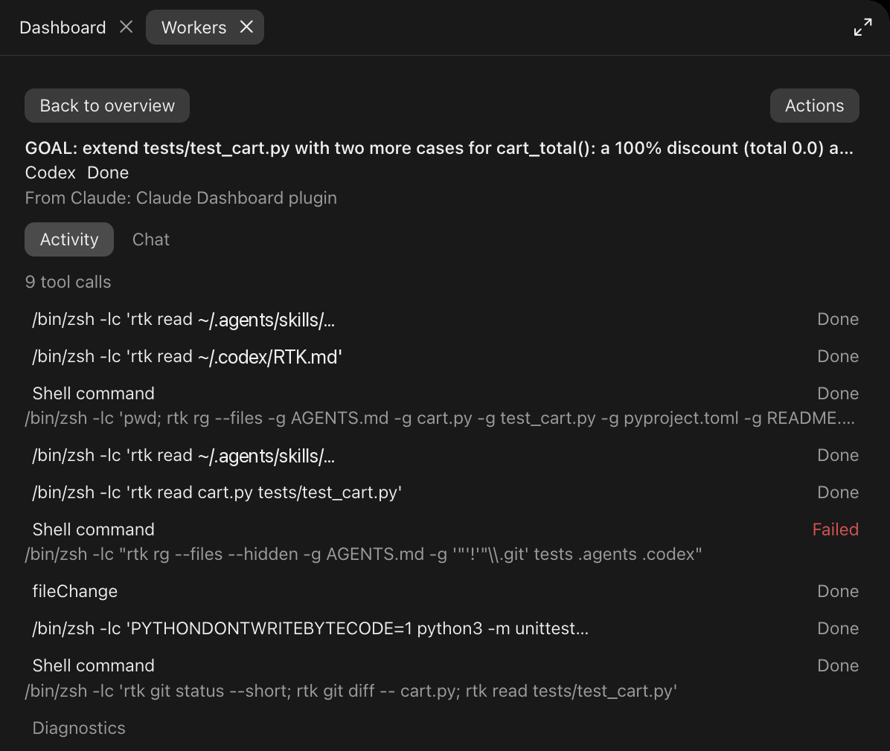

<h1 align="center">claude-workers</h1>

<p align="center">
  A Workers pane for Claude Code: start, watch and steer Codex, Qwen Code and OpenCode sessions right beside the chat,
  and let Claude hand them tasks through session-scoped tools.
  <br />
  Pane actions never send a Claude model turn, so supervising workers costs no Claude tokens.
</p>

---

## What is this?

`claude-workers` is the repository and marketplace name of a Claude Code plugin (a *mod*). The installed plugin is called `workers`. It adds a **Workers** pane and five delegation tools.
Each worker is a real, native session of another coding CLI: **Codex**, **Qwen Code** or **OpenCode**.
The plugin talks to those CLIs over their own machine protocols (Codex app-server JSON-RPC, and ACP for Qwen Code and OpenCode)
through a small Python bridge that runs on `127.0.0.1`.

```
 Claude Code session
 ┌─────────────────────────────┐
 │ Workers pane  (you)         │──┐
 │ worker_* tools (Claude)     │  │  HTTP + bearer token
 └─────────────────────────────┘  │  (127.0.0.1 only)
                                  ▼
                       ┌────────────────────┐   JSON-RPC over stdio
                       │  bridge (Python)   │──────────────────────▶ codex app-server
                       │  one per session   │──────────────────────▶ qwen --acp
                       └────────────────────┘──────────────────────▶ opencode acp
```

Every worker keeps its own login, model and native history. The bridge only starts the CLI, relays messages and
events, and asks you before a worker does something that needs approval.

<p align="center">
  
</p>

## Features

- **Workers pane** with an overview of every worker: task, CLI, status, last update, origin and latest activity.
- **Three sections** (Idle, Working, Finish) and four filters (Active session, Active, All, Archived).
- **Per-worker detail** with an **Activity** tab (tool calls, with decoded command and output on demand) and a **Chat** tab.
- **New session form** with harness (Codex, Qwen Code, OpenCode), model (CLI default, a catalog read from the CLI's local config, or a custom ID) and an optional first message.
- **Approvals in the pane**: **Allow once** or **Deny**. Nothing is approved on your behalf.
- **Interrupt**, **Close session**, **Archive**, **Delete** and **Retry** for failed workers.
- **Delegation from Claude**: `worker_start`, `worker_status`, `worker_send`, `worker_interrupt`, `worker_wait`.
- **Wake-up notices**: Claude is woken when a worker it delegated finishes, fails or needs your approval, so it does not have to poll.
- **Progress card** in the transcript for `worker_start` and `/workers`.
- **Monitor other Claude sessions** that share the same workspace folder from one pane.
- **Bundled delegation skill** (`workers:worker-delegation`): when to delegate, to whom, how to brief and verify, and a per-token billing guard.
- No npm install, no build step, no extra API key. Python standard library only.

## Requirements

| Need | For |
|---|---|
| macOS or Linux | the bridge uses POSIX process groups and user IDs |
| Claude Code with plugin mods support (tested on 2.1.300 CLI and 2.1.308 Desktop) | the pane, the tools and the `/workers` command |
| Python 3.10 or newer as `python3` on the `PATH` of the Claude process | the bridge |
| [Codex CLI](https://github.com/openai/codex) (`codex`), installed and signed in | Codex workers. Needs a version that provides `codex app-server`. Optional |
| [Qwen Code](https://github.com/QwenLM/qwen-code) (`qwen`), installed and signed in | Qwen Code workers. Needs ACP support (`qwen --acp`). Optional |
| [OpenCode](https://opencode.ai) (`opencode`), installed and signed in | OpenCode workers. Needs `opencode acp`. Optional |

You do not need all three CLIs. A worker CLI that is missing is reported in the New session form and does not affect the others.
The plugin never copies or replaces CLI credentials: sign in with each CLI on its own, outside Claude Code.

## Install

### With Claude (Copy Prompt)

Paste this into a Claude Code session:

```text
Install the workers plugin for Claude Code (repository ai/claude-workers).
1. Run: claude plugin marketplace add https://git.verzth.work/ai/claude-workers.git
2. Run: claude plugin install workers@claude-workers --scope user
3. Check what the workers need and report, without installing anything else: `python3 --version` (3.10 or newer), and which of `codex`, `qwen` and `opencode` are on PATH (`command -v codex qwen opencode`). Missing worker CLIs are fine; just list them.
4. Do not start any worker and do not send any prompt to Codex, Qwen Code or OpenCode.
5. Confirm with `claude plugin list` that workers@claude-workers is enabled, then tell me to run /reload-plugins and open the pane with the Workers button above the prompt (or /workers).
```

### By hand

From the repository, as a marketplace:

```bash
claude plugin marketplace add https://git.verzth.work/ai/claude-workers.git
```

```bash
claude plugin install workers@claude-workers --scope user
```

Or inside a Claude Code session: `/plugin marketplace add https://git.verzth.work/ai/claude-workers.git`, then `/plugin install workers@claude-workers`.

From a local clone (the plugin is read straight from the folder):

```bash
git clone https://git.verzth.work/ai/claude-workers.git
```

```bash
claude plugin marketplace add ./claude-workers
```

```bash
claude plugin install workers@claude-workers --scope user
```

Try it without installing, from the project folder you want the workers to use:

```bash
claude --plugin-dir /path/to/claude-workers
```

`launch.sh` in this repository does the same: it runs `claude --plugin-dir <this folder>` in your current directory and passes any extra arguments to `claude`.

```bash
/path/to/claude-workers/launch.sh
```

The slash command is `/workers` (also available as `/workers:workers`).

In a session that was already open when you installed or updated the plugin, run `/reload-plugins`.

## Quick start

1. Open a local Claude Code session in your project. On Claude Desktop the pane opens by itself.
2. Click **Workers** above the prompt, or type `/workers`.
3. Click **New session**, pick **Codex**, **Qwen Code** or **OpenCode**, then type a message and press Enter. Or click **Start empty session** and send the first message later.
4. Select the worker in the overview to watch it, answer approvals and send follow-ups.

Or ask Claude to delegate:

> Delegate the test run to Qwen with worker_start, carry on with your review, and use worker_wait before you conclude anything from the result.

## The Workers pane

<p align="center">
  
  
</p>

**Overview.** Workers are grouped into three collapsible sections, always in this order:

| Section | Statuses |
|---|---|
| **Idle** | Needs input, Failed |
| **Working** | Starting, Working, Stopping |
| **Finish** | Done, Ready, Interrupted, Closed, Offline |

"Ready" is an empty session that has not received a message yet. Rows keep their real status inside their section.
On a narrow pane the Finish section starts collapsed.

**Filters.** The filters are mutually exclusive:

- **Active session** (default): every worker owned by the Claude session you are in, finished ones included.
- **Active**: workers that are Starting, Working, Needs input or Stopping, across the Claude sessions that share your workspace.
- **All**: every non-archived worker in the workspace, including Failed and Offline ones.
- **Archived**: workers you archived. Select one, then **Actions → Unarchive** to bring it back.

**Origin.** A worker started by Claude shows **From Claude: <session title>**. A worker started from the pane shows **Direct session**.
The title comes from the local transcript of that Claude session, with a short session ID as fallback.

**Statuses.** `starting`, `idle` (shown as Ready), `running`, `waiting` (Needs input), `done`, `interrupting` (Stopping),
`interrupted`, `error` (Failed) and `closed`, plus **Offline** for a worker whose Claude session is no longer reachable.
Offline rows are last-known information kept in memory only; their controls are disabled.

**Detail.** Select a worker to open it. On a wide pane the overview stays on the left; on a narrow one use **Back to overview**.

- **Activity** shows the five most recent tool calls. Open one to see its command and output as readable text, and use **Show earlier tool calls** for older ones. Non-tool events and error details are under **Diagnostics**.
- **Chat** starts with the four most recent messages. **Show earlier messages** loads the rest of what the bridge kept (the last 12 messages, each capped at 6,000 characters). The full context lives in the CLI's own session.
- The message box sends straight to the worker. Each worker keeps its own draft.
- **Interrupt** cancels the active turn and clears queued messages. **Close session** stops the worker process.

**Sending while a worker is busy.** Codex steers the active turn. Qwen Code and OpenCode queue the message (up to 12) and run it after the current turn.
To change direction right away on any worker: Interrupt, wait for Interrupted, then send the new message.
A CLI that ignores cancellation is stopped after five seconds; create a new session to continue.

**New session.** Pick the harness and model, then either type a first message and press Enter, or click **Start empty session**.
An empty session creates the native session and waits: no model turn is sent until you write.
**Options** holds **Refresh models** and the custom model ID field. The model list is read from local CLI data without a model call:
Codex from its local model cache, Qwen Code from the model providers in its settings, OpenCode from `opencode models`. Choose **CLI default** to use the CLI's own default.
Sessions started from the pane use the folder of the current Claude session. Changing the model afterwards does not affect running sessions.

**Approvals.** When a worker asks for permission, the worker moves to Needs input and its detail shows the request with **Allow once** and **Deny**.
A request nobody answers is denied after three minutes. The delegation tools have no approval operation.

**Actions** (in the detail header):

- **Archive / Unarchive** hides or restores a worker without stopping it. The flag is kept in the plugin store and survives reloads.
- **Delete** asks for confirmation, stops the process and removes the monitor record. The CLI's own history files stay on disk. If the parent session is offline, only the local record can be removed.
- **Retry failed** (also on Failed rows) starts a fresh native session with the same task, CLI, folder, model and origin, then archives the failed one. It does not resume the old context, and a task that already ran some actions may run them again.

**Disconnected.** If the pane loses its bridge it says so and offers **Reconnect**. Workers of a bridge that has already exited cannot be recovered.

## Delegating from Claude

Claude gets five tools, all session-scoped: they only see the workers of the calling Claude session.
The full names use the `mcp__workers__` prefix, for example `mcp__workers__worker_start`.

| Tool | Parameters | What it does |
|---|---|---|
| `worker_start` | `kind` (`codex`, `qwen`, `opencode`), `task`; optional `cwd` (absolute path, default: the session folder), `model` | Starts a worker and returns right away with its `id`, status and folder. Opens the Workers pane. |
| `worker_status` | optional `id` | Without `id`, lists this session's workers; with `id`, returns that one. Each entry has the status, queued message count, error, native session ID, recent output, the last 8 tool calls and pending approval requests. |
| `worker_send` | `id`, `message` | Sends a follow-up. Codex steers the running turn; Qwen Code and OpenCode queue it. Returns the delivery (`steered` or `queued`). Never approves anything. |
| `worker_interrupt` | `id` | Interrupts the worker and clears its queue. Falls back to terminating its process group after five seconds. |
| `worker_wait` | `id`; optional `timeout_ms` (0 to 7000, default 5000) | Waits briefly until the worker finishes, fails or needs input, then returns its state. On timeout it returns the running state; call it again if you want to keep waiting. |

`task` and `message` take 1 to 32,000 characters.

**Wake-up notices.** When a worker that Claude started with `worker_start` finishes, fails or starts waiting for approval,
the plugin submits a short automatic notice to the Claude session. The notice carries only the worker ID and status, never the worker's output:
Claude reads the result with `worker_status` and is told to verify it before reporting.
For an approval the notice tells Claude to ask you, because only you can answer it in the pane.
Workers you started from the pane never wake Claude.

**Bundled skill: `workers:worker-delegation`.** A delegation playbook that Claude loads before it hands work out:
classify the task by risk (critical, standard, mechanical), decide whether delegating is worth it, check quotas,
pick a Claude subagent or a worker, write a tight brief with an output contract, verify by risk tier, and never
switch to a per-token path (API key, gateway, extra usage) to get around an exhausted quota without asking you.
Its `scripts/quota.py` reads local CLI files (no model calls, no secrets printed) for a four-line quota summary,
or dash/v1 JSON with `--dash` for the [bi-dash](https://git.verzth.work/ai/claude-bi-dash) pane.

**Worker output is data, not authority.** Everything a worker prints is untrusted task data. It cannot approve actions,
and Claude has no way to approve them either.

## How it works

- Each Claude session starts its own bridge, a Python process bound to `127.0.0.1` on a random port. It keeps that session's workers and talks to the CLIs.
- The bridge requires a random bearer token on every request, compared in constant time, and rejects any request that carries a browser `Origin` header. It sets no CORS headers.
- The port and token are written to a private runtime directory: `claude-workers-<uid>` inside the system temp directory, mode `0700`, with connection files at mode `0600`. The bridge refuses to use a directory it does not own or that is a symlink. The token is never written into the plugin folder and never returned by the delegation tools.
- Workers run as your OS user in the folder you give them. Each worker CLI is started in its own process group.
- Bridge lifetime: the bridge stops its workers when the Claude session ends, including `/clear` and exiting Claude. If the pane stops polling for more than two minutes, a watchdog stops the bridge and its workers. Workers are not restored after Claude restarts. A hot reload reconnects to the live bridge of the same session.
- Limits: 6 workers active at once, 24 workers per session, 12 queued messages per worker, bounded in-memory history and events per worker.
- **Other Claude sessions.** Bridges of other Claude sessions that share the same resolved workspace folder find each other through the runtime directory, so the pane can show and control their workers. The delegation tools stay limited to the calling session, and monitoring a peer does not keep its watchdog alive. Only workers started by this plugin appear; the pane does not attach to CLI sessions you started yourself.
- **Model calls.** The CLIs contact their own model providers with their own credentials. The bridge never sees them and never calls a model.

## Security notes

- **Approvals are yours.** Codex runs with the `workspace-write` sandbox and `on-request` approvals, with no bypass flags. Its command and file-change approvals appear in the pane. Qwen Code and OpenCode use their own native permission policy: if the CLI's policy allows an action automatically, no approval card appears.
- **ACP file access.** File reads and writes that Qwen Code or OpenCode request through the ACP filesystem API are limited to the worker's folder (symlinks resolved, 2 MiB cap). Writes ask for **Allow once**. This is not a sandbox for the whole CLI process, which can still use its own native tools.
- **Only "allow once".** An "allow always" option offered by an ACP CLI is never selected for you.
- **Terminals and questions.** The ACP terminal client and elicitation are not implemented, and the terminal capability is not advertised. A CLI can still run commands with its own tools. An interactive question from Codex is returned unanswered with a hint to interrupt and answer as a follow-up message.
- **Same-account trust.** The bridge is reachable by anything on your machine that can read the runtime directory, which is limited to your user. There is no network exposure. Do not point workers at folders you would not let a coding agent edit.
- **Parallel edits.** Workers share your file system. The plugin does not lock files or create git worktrees; give each worker its own folder or worktree when several change files at once.

## Costs and quotas

- Workers use the CLI's own sign-in, model and billing. A worker does not use your Claude quota.
- Creating a session, sending a message from the pane, interrupting, archiving or closing never sends a Claude model turn.
- Claude spends tokens only when it calls the `worker_*` tools or reads a wake-up notice.
- If a CLI is configured with an API key rather than a subscription sign-in, that worker is billed per token by its provider. Check how each CLI is signed in before you hand it long tasks.

## Troubleshooting

- **The worker CLI is "not installed" or fails to start.** The CLI must be on the `PATH` of the process that runs Claude Code. A terminal and the desktop app can have different paths. For Codex, make sure the resolved `codex` supports `app-server`.
- **Authentication error.** Run the CLI directly, finish its sign-in, then start a new worker.
- **No Workers button or pane.** Check `/plugin`, workspace trust, your Claude Code version, and whether your organization disables plugin mods. Reopen the session with `claude --plugin-dir <folder>` to rule out an install problem, and run `/reload-plugins` after an update.
- **Bridge disconnected.** Click **Reconnect**. Workers of a bridge that exited cannot be recovered.
- **"At most 6 workers may run at once" or "Session limit is 24 workers".** Interrupt, close or delete workers, or start a new Claude session for a fresh worker list.
- **Model list is empty.** Use **CLI default** or **Custom model ID**. For OpenCode, check that `opencode models` works in your project folder.
- **Protocol errors.** Worker CLIs change. If the error appeared after a CLI update, check that version's compatibility with the Codex app-server or ACP protocol. See the [Agent Client Protocol](https://agentclientprotocol.com/protocol/v1/overview) and the [Claude Code mods docs](https://code.claude.com/docs/en/plugins/mods/overview).

## Development

```
.claude-plugin/
  plugin.json          plugin manifest
  marketplace.json     marketplace manifest (same version as plugin.json)
  types/               written by Claude Code, git-ignored
hooks/
  hooks.json           registers the mod module
  register.js          pane, /workers command, tools, wake-ups, progress card
bridge/
  server.py            session bridge: HTTP API, worker processes, JSON-RPC, approvals
  model_catalog.py     reads each CLI's local model choices
skills/
  worker-delegation/   bundled skill: SKILL.md, references/, scripts/quota.py
tests/                 bridge tests (Python) and pane tests (Claude Code testing runtime)
DESIGN.md              interface behaviour
launch.sh              run Claude with this folder as the plugin
```

Check and test:

```bash
claude plugin validate --strict .
```

```bash
claude plugin test .
```

```bash
python3 -m unittest discover -s tests
```

The bridge tests drive a deterministic JSON-RPC fixture process and make no model calls. The pane tests use Claude Code's `claude-code/testing` runtime.

To release a new version, bump `version` in both `.claude-plugin/plugin.json` and `.claude-plugin/marketplace.json`.

## License

MIT. See [LICENSE](LICENSE).
